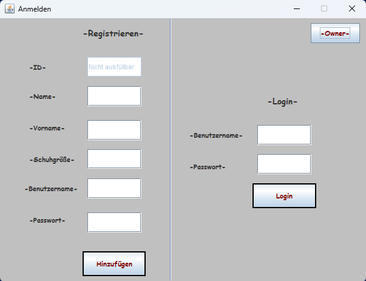
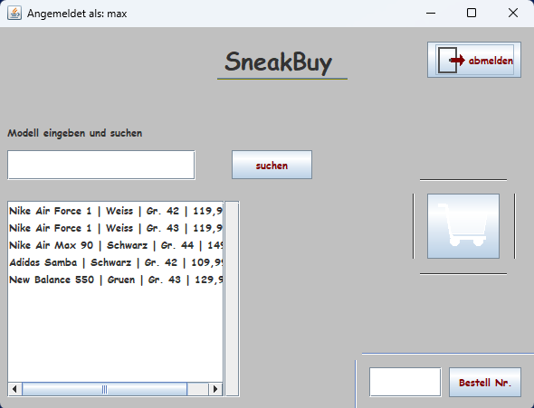
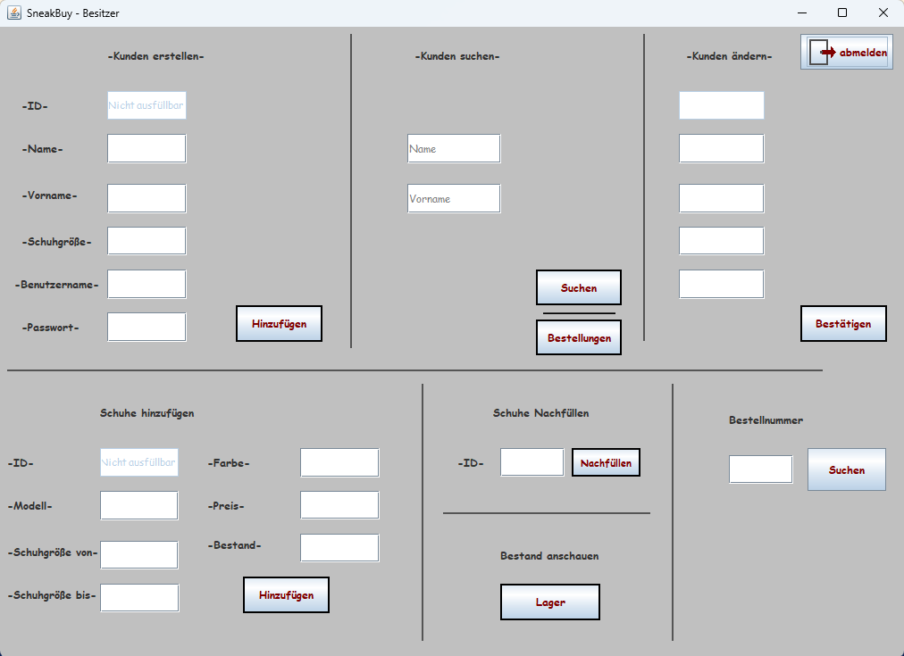

# SneakBuy – Sneaker-Shop in Java

SneakBuy ist ein kleiner Online-Shop für Sneaker als Desktop-Programm. Ich habe ihn als Schulprojekt im Fach Informatik selbst programmiert.
Kunden können sich registrieren, Schuhe suchen, sie in den Warenkorb legen und bestellen. Der Besitzer verwaltet Kunden, Schuhe, Lagerbestand und Bestellungen.

## Ausprobieren

1. [`download/SneakBuy.jar`](download/SneakBuy.jar) herunterladen (Java 8 oder neuer muss installiert sein).
2. Doppelklick auf die Datei. Die Datenbank wird beim ersten Start automatisch im selben Ordner angelegt.
3. Oben rechts auf **-Owner-** klicken (Passwort: `1234`) und ein paar Schuhe anlegen.
4. Zurück zum Login, einen Kunden registrieren, einloggen und einkaufen.

## Screenshots

| Login und Registrierung | Kundenbereich |
|---|---|
|  |  |

**Besitzerbereich**

## Funktionen

**Kunde**
- Registrieren und Einloggen (Passwörter werden nur als SHA-256-Hash gespeichert)
- Schuhe nach Modell suchen (ausverkaufte Schuhe werden nicht angezeigt)
- Per Doppelklick in den Warenkorb legen, mit Prüfung des Lagerbestands
- Warenkorb mit Gesamtbetrag ansehen und kaufen, danach gibt es eine Bestellnummer
- Eigene Bestellungen über die Bestellnummer aufrufen

**Besitzer**
- Kunden anlegen, suchen und ändern
- Schuhe in mehreren Größen auf einmal anlegen
- Bestand nachfüllen und das ganze Lager ansehen
- Bestellungen nach Nummer oder nach Kunde ansehen

## Technik

- **Java** mit **Swing** für die Oberfläche (erstellt mit dem Java-Editor)
- **SQLite**-Datenbank über **JDBC** mit vier Tabellen: Kunden, Schuhe, Warenkorb, Bestellungen
- `PreparedStatement` gegen SQL-Injection
- Der Kauf läuft als Transaktion: Ist von einem Schuh nicht mehr genug da, wird nichts gebucht

## Aufbau

| Datei | Aufgabe |
|---|---|
| `SneakerShop.java` | Datenbank-Logik (Tabellen anlegen, alle Abfragen) |
| `GuiKundeLogin.java` | Startfenster: Registrieren und Login (Startklasse) |
| `GuiKunde.java` | Kundenbereich: Suche, Warenkorb, Bestellungen |
| `owner_login.java` | Passwortabfrage für den Besitzer |
| `GuiBesitzer.java` | Besitzerbereich: Kunden, Schuhe, Lager, Bestellungen |
| `GuiBestellung.java` | Fenster zur Anzeige einer Bestellung |

Die `.jfm`-Dateien sind die Formulardateien des Java-Editors.

## Selbst kompilieren

Benötigt werden der [SQLite-JDBC-Treiber](https://github.com/xerial/sqlite-jdbc) und die Klasse `JNumberField` aus `JEClasses.jar` des [Java-Editors](https://javaeditor.org). Beides muss im Classpath liegen. Startklasse ist `GuiKundeLogin`.

---
Sven Kraemer, 2026
